<div align="center">

# Koushik Katkam

### Full-Stack Systems Builder · Applied AI & Data Engineering · Mobile & Spatial Computing
**Warangal / Hyderabad, India · B.Tech Data Science, KUCET**

[GitHub](https://github.com/KatkamKoushik) · [LinkedIn](https://linkedin.com/in/koushik-katkam) · [Instagram](https://www.instagram.com/koushik_katkam) · [Email](mailto:koushikkatkam@gmail.com)

```yaml
system_telemetry:
  core_focus: "Edge Computer Vision, AST SQL Sandboxing, Document Intelligence, Geospatial Routing"
  engineering_creed: "Explicit validation, mathematical invariants, data provenance, honest disclosures"
  public_ecosystem: "13 verified repositories · 1,000+ automated tests · 4 monorepos · 8 live deployments"
  runtime_status: "Shipping production-grade distributed, mobile, and web software"
```

</div>

---

## 🏛️ Systems Architecture & Verification Topology

```mermaid
flowchart LR
    subgraph Tier1["1. Edge, Mobile & Sensor Subsystems"]
        K2["K² FRS Canonical<br/>SCRFD + ArcFace (τ=0.60)<br/>86 Tests · Ephemeral Wipe"]
        Kinex["KinexMed<br/>MediaPipe Tasks + CameraX<br/>87 Tests · Android APK v1.0.0"]
        Walk["Walkscope<br/>MapLibre Native + Fastify<br/>229 Tests · Zero Telemetry"]
        Street["StreetSense<br/>Selective Multi-Expert FSM<br/>16 Tests · Room SQLite"]
    end

    subgraph Tier2["2. Intelligence, AST Safety & Security Telemetry"]
        Schema["SchemaSense AI<br/>sqlglot AST SQLGuard<br/>417 Tests · Multi-Cloud SSO"]
        Notice["NoticeSync<br/>pgvector 768-dim RAG<br/>144 Tests · ICS Export"]
        Guard["GuardAI<br/>SSRF Pinned IP + Shannon Entropy<br/>80 Tests · 3D WebGL Globe"]
        Cyclone["CycloneSense<br/>NetCDF4/HDF5 + W3C PROV<br/>55 Tests · PyTorch Grad-CAM"]
    end

    subgraph Tier3["3. Production Monorepos & Creative Computing"]
        Build["BuildMart Monorepo<br/>Next.js 15 + FastAPI + Flutter<br/>v2.0.0 APK Asset"]
        Ecosystem["Restaurant Ecosystem<br/>4 Brands · Clerk · Firestore<br/>4 Live Production Sites"]
        Vyshuuu["VYSHUUU Haute Couture<br/>React Three Fiber + GLSL<br/>95 Locked CDN Assets"]
        Heal["HealX Healthcare<br/>Bilingual Next.js + Gemini API<br/>Live Demo + Demo Mode"]
    end

    Tier1 -->|Cryptographic Verification & Local SQLite| Tier2
    Tier2 -->|Zero-Trust Gateways & Dialect AST Sandboxes| Tier3
```



---

## ⚡ Systems Engineering Matrix (13 Verified Repositories)

| System | Primary Domain | Core Architecture & Invariant | Verified Proof & Tests | Live Deployment / Docs |
| :--- | :--- | :--- | :--- | :--- |
| **[K² Attendance](https://github.com/KatkamKoushik/K-Squared-Face-Recognition-Attendance-System)** | Edge Computer Vision | Asynchronous multi-face sweep; vision acts as **evidence producer**, not decision maker; ephemeral frame wiping | **86** unit/gov tests, **15** Playwright E2E, **5** invariant suites | [Official GitHub Wiki](https://github.com/KatkamKoushik/K-Squared-Face-Recognition-Attendance-System/wiki) |
| **[NoticeSync](https://github.com/KatkamKoushik/NoticeSync)** | Document Intelligence | Grounded RAG with Supabase pgvector; multi-document deadline revision reasoning & human-in-the-loop review | **144** tests across 38 suites, **100%** extraction F1 on benchmark | [Live App](https://notice-sync.vercel.app) · [Wiki](https://github.com/KatkamKoushik/NoticeSync/wiki) |
| **[GuardAI](https://github.com/KatkamKoushik/guardai)** | DevSecOps & Threat Intel | Pinned IP transport (SSRF defense), Shannon entropy heuristics, 3D WebGL threat globe, automated feed abstention | **80** Vitest tests, **11** Playwright E2E, **20-vector** SSRF suite | [Live App](https://guardai-six.vercel.app) · [Wiki](https://github.com/KatkamKoushik/guardai/wiki) |
| **[SchemaSense AI](https://github.com/KatkamKoushik/schemasense)** | Data Governance & AST | `SQLGuard` with `sqlglot`: dialect AST sandbox, read-only SELECT/UNION enforcement, PII classification, OAuth SSO | **417** tests (91% cov), **54** adversarial AST tests, CycloneDX SBOM | [Streamlit Console](https://neural-nexus-schemasense-n9aixu78zu8ebbbahcvvhc.streamlit.app/) |
| **[Walkscope](https://github.com/KatkamKoushik/Walkscope)** | Geospatial Mobility | Verifiable Route Context Coverage (0-100%); projected venue opening hours; zero advertising trackers or telemetry | **229** tests, $p_{50} < 100\text{ms}$ SLA, **500+** ReDoS fuzz immunity | [GitHub Source](https://github.com/KatkamKoushik/Walkscope) |
| **[KinexMed](https://github.com/KatkamKoushik/KinexMed)** | Clinical Movement AI | MediaPipe Tasks Vision + CameraX; 100% on-device joint geometry & One-Euro filtering; zero frame retention | **87** tests (50 backend, 32 Android, 5 web), Alembic migrations | [Release v1.0.0 (APK)](https://github.com/KatkamKoushik/KinexMed/releases/tag/v1.0.0) |
| **[CycloneSense](https://github.com/KatkamKoushik/cyclonesense)** | Scientific Earth Observation | NOAA GOES & NASA Earthdata ingestion; multimodal PyTorch Grad-CAM interpretability; W3C PROV lineage | **55** tests (48 portable subset); proxy data audit disclosed | [Release v1.0.0](https://github.com/KatkamKoushik/cyclonesense/releases/tag/v1.0.0) |
| **[BuildMart](https://github.com/KatkamKoushik/BuildMart)** | B2B Commercial Monorepo | Next.js 15 + FastAPI + Flutter procurement platform; role-based workflows; multi-target CI | **59** backend API tests passing with verified execution report | [Release v2.0.0 (APK)](https://github.com/KatkamKoushik/BuildMart/releases/tag/v2.0.0) |
| **[Restaurant Ecosystem](https://github.com/KatkamKoushik/restaurant-ecosystem)** | Hospitality Monorepo | Turborepo consolidating 4 distinct brand platforms with Clerk authentication and Firestore persistence | Co-authored with Vyshnavi Nagavelli; multi-app production builds | [Sampradaya](https://sampradaya-multicuisine-family-rest.vercel.app/) · [Majesty](https://majesty-mandi-house-eight.vercel.app/) · [Mandiwala](https://mandiwala-arabian-restaurant.vercel.app/) · [Aroma](https://aroma-fine-dine-restaurant-banquet.vercel.app/) |
| **[HealX](https://github.com/KatkamKoushik/HealX)** | Inclusive Healthcare | Bilingual (Telugu/English) navigation with browser TTS, Gemini-assisted search, and offline Demo Mode | Developed for SFIC Level 3; simulated regional facility records | [Live App](https://healx-six.vercel.app) |
| **[VYSHUUU](https://github.com/KatkamKoushik/vyshuuu)** | Computational Haute Couture | Saree digital loom: Three.js/R3F persistent canvas, custom GLSL pleat shaders, Lenis + GSAP scroll | 95 locked CDN production assets; 10-saree collection architecture | [Live Experience](https://vyshuuu-five.vercel.app) |
| **[StreetSense](https://github.com/KatkamKoushik/streetsense)** | Edge Kinetic Sensing | Multi-sensor pedestrian safety pipeline with selective-escalation architecture and Room persistence | **16** tests; honest `UNAVAILABLE` reporting when vision weights absent | [Release v1.0.0](https://github.com/KatkamKoushik/streetsense/releases/tag/v1.0.0) |
| **[Proposal Website](https://github.com/KatkamKoushik/proposal-website)** | Creative Computing | Dark-mode interactive visual storytelling with glowing typography and Framer Motion transitions | Verified responsive layout and scene transitions | [Live App](https://proposal-website-drab.vercel.app/) |

---

## 🛡️ Core Engineering Principles & Invariants

```
┌───────────────────────────────┬────────────────────────────────────────────────────────────────────────┐
│ Principle                     │ Production Implementation Guarantee                                    │
├───────────────────────────────┼────────────────────────────────────────────────────────────────────────┤
│ Evidence-First AI             │ Neural models output structured evidence proposals with confidence     │
│                               │ thresholds (tau=0.60 in K²), never authoritative unsupervised commits. │
├───────────────────────────────┼────────────────────────────────────────────────────────────────────────┤
│ AST-Level Query Sandboxing    │ Database queries parsed via sqlglot into Abstract Syntax Trees, forcing│
│                               │ single-statement read-only execution with strict catalog allowlists.   │
├───────────────────────────────┼────────────────────────────────────────────────────────────────────────┤
│ Ephemeral Zero-Telemetry      │ In-memory video/frame analysis via CameraX; zero raw biometric retention│
│                               │ or advertising tracking SDKs; local SQLite storage by default.         │
├───────────────────────────────┼────────────────────────────────────────────────────────────────────────┤
│ Honest Scientific Caveats     │ Explicit disclosure of synthetic proxies, prototype boundaries, and    │
│                               │ unpackageable edge weights (CycloneSense, StreetSense, HealX).         │
└───────────────────────────────┴────────────────────────────────────────────────────────────────────────┘
```

---

## 🔬 Featured System Dossiers

<details open>
<summary><b>1. Edge Computer Vision & Clinical Biometrics (K² & KinexMed)</b></summary>
<br>

* **[K² (FRS V7.1 Canonical)](https://github.com/KatkamKoushik/K-Squared-Face-Recognition-Attendance-System):** Institutional classroom-photo attendance proposal system built for Kakatiya University College of Engineering & Technology (KUCET). Replaces single-face biometric punch kiosks and paper attendance ledgers with an asynchronous, multi-face classroom sweep workflow. Integrates SCRFD face detection and ArcFace ResNet-50 embeddings (open-set $\tau=0.60$) with ONNX Runtime. Enforces ephemeral frame wiping, client SHA-256 anchoring, zero raw facial image storage, 86 unit and governance tests, 15 Playwright E2E browser tests, and 5 mathematical invariant suites.
  * **Stack:** Python 3.12, FastAPI, Flutter, Next.js 15, PostgreSQL 16, SCRFD, ArcFace, ONNX Runtime, Docker Compose
  * **Documentation:** [Official Technical Wiki](https://github.com/KatkamKoushik/K-Squared-Face-Recognition-Attendance-System/wiki)

* **[KinexMed](https://github.com/KatkamKoushik/KinexMed):** Edge-native clinical movement intelligence and physical rehabilitation platform built for the iQOO Hackathon 2026 (Hyderabad City Battle). Employs MediaPipe Tasks Vision (Pose Landmarker) and CameraX for 100% on-device pose tracking, One-Euro temporal filtering, Euclidean joint geometry, and finite-state machine repetition counting across 15 clinical exercises. Integrates Alembic database migrations, clinician REST endpoints with API-key authentication and strict CORS whitelisting, and a React clinician portal.
  * **Validation & Disclaimer:** 87 automated tests passing across Backend & Playwright (50), Android Subsystem (32), and Web Clinician Portal (5). Raw camera frames are analyzed in-memory and immediately freed with zero video/images stored or transmitted. Assistive observation tool; not a substitute for professional medical diagnosis.
  * **Release:** [KinexMed v1.0.0 on GitHub Releases](https://github.com/KatkamKoushik/KinexMed/releases/tag/v1.0.0) (includes downloadable Android debug APK).
  * **Stack:** Kotlin, Android SDK, MediaPipe Tasks Vision, CameraX, Python 3.12, FastAPI, React, Vite, SQLite, Alembic

</details>

<details>
<summary><b>2. Security Telemetry & Data Governance (GuardAI & SchemaSense AI)</b></summary>
<br>

* **[GuardAI](https://github.com/KatkamKoushik/guardai):** Automated threat intelligence, lexical heuristic evaluation, and active cryptographic scanning platform. Combines DNS/TLS inspection, external reputation lookups (VirusTotal, Google Safe Browsing, AbuseIPDB, URLhaus), Shannon entropy heuristics, and Server-Sent Events (SSE) scan telemetry. Features an interactive Three.js/WebGL threat globe with custom GLSL shaders and GSAP animation.
  * **Security & Abstention Policy:** 80 Vitest security/regression tests, 11 Playwright E2E tests, 20-vector SSRF test suite with pinned IP transport, rootless multi-stage Docker container (`UID 1001`), and OpenAPI 3.1 schema. When external threat feeds are absent, the scanner returns an `INCONCLUSIVE` verdict rather than producing fabricated risk classifications.
  * **Live Demo:** [guardai-six.vercel.app](https://guardai-six.vercel.app) · **Documentation:** [GuardAI Wiki](https://github.com/KatkamKoushik/guardai/wiki)
  * **Stack:** Next.js 16, React 19, TypeScript, Prisma, PostgreSQL 16, NextAuth, Three.js, GLSL, Tailwind CSS v4, Docker

* **[SchemaSense AI](https://github.com/KatkamKoushik/schemasense):** Enterprise AI Data Steward & multi-cloud schema intelligence console connecting to PostgreSQL, MySQL, SQLite, AWS RDS, Cloud SQL, Supabase, and Neon. Generates interactive data dictionaries, audits column quality, classifies sensitive PII entities, and provides one-click DBML/DDL exports.
  * **AST Guardrails:** Implements `SQLGuard` via `sqlglot`: dialect-aware AST parser restricting queries to read-only SELECT/UNION operations, enforcing table allowlists, blocking system catalogs, and preventing injection. Features an enterprise zero-trust access gate supporting Google and GitHub OAuth 2.0 SSO, with universal cloud and local model inference (Gemini, Claude, GPT-4o, llama.cpp).
  * **Verification:** 417 tests passing (91% code coverage), 54 adversarial SQL AST tests, CycloneDX SBOM v1.5, and detect-secrets audited baseline.
  * **Live Console:** [SchemaSense on Streamlit](https://neural-nexus-schemasense-n9aixu78zu8ebbbahcvvhc.streamlit.app/)
  * **Stack:** Python, Streamlit, SQLAlchemy, sqlglot, PostgreSQL, MySQL, SQLite, Google Gemini API, Anthropic Claude, llama.cpp

</details>

<details>
<summary><b>3. Document Intelligence & Geospatial Mobility (NoticeSync, Walkscope, CycloneSense, StreetSense)</b></summary>
<br>

* **[NoticeSync](https://github.com/KatkamKoushik/NoticeSync):** Ingests university circulars, exam timetables, and syllabi into structured dates using document-grounded RAG (Supabase pgvector, 768-dimensional embeddings). Resolves multi-document deadline revisions and temporal conflicts with human-in-the-loop review gating for ambiguous or conflicting dates.
  * **Verification & Limitations:** 144 tests across 38 suites, streaming byte bounds, decompression bomb defense, CSRF Fetch Metadata protection, and an empirical benchmark suite (100% extraction F1, 0% false confirmations). Evaluated on 11 synthetic, privacy-safe university circulars; calendar events export as `.ics` files (automatic Google Calendar sync is not implemented).
  * **Live Demo:** [notice-sync.vercel.app](https://notice-sync.vercel.app) · **Documentation:** [NoticeSync Wiki](https://github.com/KatkamKoushik/NoticeSync/wiki)
  * **Stack:** Next.js 16, React 19, TypeScript, Supabase (pgvector), Vercel AI SDK, Tesseract.js, pdf-parse, Langfuse

* **[Walkscope](https://github.com/KatkamKoushik/Walkscope):** Mobile-first pedestrian navigation companion replacing opaque, subjective "safety scores" with verifiable Route Context Coverage (0 to 100%) and Route Context Intelligence. Evaluates OSM venue opening hours at projected arrival time, along-route venue distribution gaps, major-road share breakdown, verified support-point registry, and an auditable "Why This Route?" evidence drawer.
  * **Privacy & Resilience:** Zero analytics SDKs or advertising trackers; all journey history remains in local-first SQLite. Dedicated Fastify gateway with request deduplication, rate limiting, and in-memory TTL caching with graceful standalone fallback. Verified support-point registry requires independently audited access evidence (defaults to 0 points).
  * **Verification:** 229/229 passing tests, SLA latency bounds ($p_{50} < 100\text{ms}$), ReDoS fuzzing immunity across 500+ patterns, and nearest line-segment off-route detection with kinematic teleportation filtering.
  * **Stack:** React Native, Expo 58, TypeScript, Node.js 22 LTS, Fastify, MapLibre Native, SQLite, Docker, Redis, PostGIS

* **[CycloneSense](https://github.com/KatkamKoushik/cyclonesense):** Ingests and validates Earth-observation data alongside official storm-track records, including workflows for NOAA GOES-16/18 ABI data and NASA Earthdata CMR. Uses Python and PyTorch for exploratory cyclone modeling, Grad-CAM spatial visualizations, and provenance tracking aligned with W3C PROV concepts across NetCDF4, HDF5, and xarray scientific data.
  * **Verification & Validation Caveat:** 55 automated tests passing. The repository's model audit identifies the image-only model's raster inputs as synthetic proxy data and the fusion model as a hybrid; reported scores reflect exploratory architecture rather than validated predictive accuracy on authentic satellite imagery.
  * **Release:** [CycloneSense v1.0.0 on GitHub Releases](https://github.com/KatkamKoushik/cyclonesense/releases/tag/v1.0.0).
  * **Stack:** Python, FastAPI, PyTorch, Next.js, NetCDF4, HDF5, xarray, SQLAlchemy, Celery

* **[StreetSense](https://github.com/KatkamKoushik/streetsense):** Combines Android sensor inputs (accelerometer, gyroscope, GPS, ambient light, camera) with a backend event pipeline. Implements a selective-escalation architecture intended to call more expensive specialist checks when sensor evidence is ambiguous.
  * **Verification, Limitations & Release:** 16 passing tests (12 backend + 4 on-device). The repository verification matrix clarifies that edge-vision weights are not pre-packaged; when absent, the vision expert safely reports `UNAVAILABLE` rather than returning fabricated detections. [StreetSense v1.0.0 on GitHub Releases](https://github.com/KatkamKoushik/streetsense/releases/tag/v1.0.0).
  * **Stack:** Kotlin, Jetpack Compose, CameraX, Android Room, Python, FastAPI, React, SQLite, PostGIS, WebSockets

</details>

<details>
<summary><b>4. Production Monorepos & Creative Computing (BuildMart, Restaurant Ecosystem, HealX, VYSHUUU, Proposal)</b></summary>
<br>

* **[BuildMart](https://github.com/KatkamKoushik/BuildMart):** Consolidates a Next.js 15 commercial procurement web application, a FastAPI backend service, and a Flutter mobile client into a B2B procurement monorepo. Implements multi-tenant marketplace workflows, role-based procurement operations, backend API tests, and multi-target CI configuration.
  * **Verification & Release:** 59 backend API tests passing with documented test-execution report. [BuildMart v2.0.0 on GitHub Releases](https://github.com/KatkamKoushik/BuildMart/releases/tag/v2.0.0) (includes downloadable Android APK asset).
  * **Stack:** Next.js 15, TypeScript, FastAPI, Python, Flutter, Dart, pnpm, Turborepo

* **[Restaurant Ecosystem](https://github.com/KatkamKoushik/restaurant-ecosystem):** Consolidates four restaurant applications: Sampradaya, Majesty Mandi House, Mandiwala, and Aroma, with distinct brand aesthetics and deployment workflows. Implements digital menus, portion-based pricing calculators, reservation workflows, Clerk authentication, and Firebase/Firestore real-time persistence. Co-authored with [Vyshnavi Nagavelli](https://github.com/nagavellivyshnavi).
  * **Live Deployments:** [Sampradaya](https://sampradaya-multicuisine-family-rest.vercel.app/) · [Majesty Mandi House](https://majesty-mandi-house-eight.vercel.app/) · [Mandiwala](https://mandiwala-arabian-restaurant.vercel.app/) · [Aroma](https://aroma-fine-dine-restaurant-banquet.vercel.app/)
  * **Stack:** Next.js 16, React, TypeScript, Turborepo, Tailwind CSS, Clerk, Firebase/Firestore

* **[HealX](https://github.com/KatkamKoushik/HealX):** Accessible bilingual healthcare-facility navigation prototype providing English/Telugu interfaces, browser text-to-speech, high-contrast controls, adjustable typography, and telephony simulation. Offers Gemini-assisted natural-language search and a Supabase-backed facility store, with an in-memory Demo Mode for offline evaluation.
  * **Data & Scope Disclosure:** Prototype developed for the Seva First Innovation Challenge (SFIC) Level 3. Default facility records are simulated sample data across South India; does not provide medical diagnosis, emergency dispatch, or official government health-record integration.
  * **Live Demo:** [healx-six.vercel.app](https://healx-six.vercel.app)
  * **Stack:** Next.js, React, TypeScript, Supabase, Google Gemini API, Tailwind CSS

* **[VYSHUUU — The Unstitched Continuum](https://github.com/KatkamKoushik/vyshuuu):** Immersive digital haute couture experience devoted to the Indian saree, unstitched silk architecture, and computational textile intelligence. Employs React Three Fiber and custom GLSL shaders (catenary drape, dynamic traveling pleats, anisotropic zari specular glints) with Lenis smooth-scroll and GSAP ScrollTrigger choreography across 11 curatorial chapters.
  * **Asset Architecture & Live Experience:** 95 locked production assets resolved via Cloudinary CDN manifest; 10 curated saree concepts honoring classical Indian textile lineages.
  * **Live Experience:** [vyshuuu-five.vercel.app](https://vyshuuu-five.vercel.app)
  * **Stack:** Next.js, React, TypeScript, Three.js, React Three Fiber, GLSL, GSAP, Lenis, Zustand, Tailwind CSS

* **[Proposal Website](https://github.com/KatkamKoushik/proposal-website):** Dark-mode visual storytelling experience featuring smooth Framer Motion scene transitions, glowing typography, and interactive particle effects.
  * **Live Demo:** [proposal-website-drab.vercel.app](https://proposal-website-drab.vercel.app/)
  * **Stack:** Next.js, TypeScript, Tailwind CSS, Framer Motion, Vercel

</details>

---

## 🛠️ Technical Capabilities & Verified Tooling

```
┌─────────────────────────────────┬────────────────────────────────────────────────────────────────────────┐
│ Domain                          │ Technologies & Applied Tooling                                         │
├─────────────────────────────────┼────────────────────────────────────────────────────────────────────────┤
│ Core Languages                  │ Python 3.12, TypeScript 5.8, JavaScript, Kotlin, Dart, SQL, GLSL      │
├─────────────────────────────────┼────────────────────────────────────────────────────────────────────────┤
│ Application & Microservices     │ FastAPI, Next.js (15/16), Fastify, Node.js 22 LTS, Streamlit, Turborepo│
├─────────────────────────────────┼────────────────────────────────────────────────────────────────────────┤
│ Mobile & Native Sensing         │ Flutter 3.27, Android SDK, Jetpack Compose, React Native / Expo 58     │
├─────────────────────────────────┼────────────────────────────────────────────────────────────────────────┤
│ AI, Computer Vision & RAG       │ PyTorch, MediaPipe Tasks Vision, SCRFD, ArcFace ResNet-50, ONNX Runtime│
│                                 │ Supabase pgvector (768-dim), Google Gemini API, Claude, sqlglot AST   │
├─────────────────────────────────┼────────────────────────────────────────────────────────────────────────┤
│ Data, Storage & Lineage         │ PostgreSQL 16, SQLite / Room, PostGIS, MySQL, Redis, Firestore, NetCDF4│
│                                 │ HDF5, xarray, SQLAlchemy 2.0, Alembic, Prisma ORM                     │
├─────────────────────────────────┼────────────────────────────────────────────────────────────────────────┤
│ Spatial Graphics & Real-Time    │ Three.js, React Three Fiber, MapLibre Native, Custom GLSL Shaders,    │
│                                 │ GSAP ScrollTrigger, Lenis, Framer Motion, SSE, WebSockets              │
├─────────────────────────────────┼────────────────────────────────────────────────────────────────────────┤
│ Quality, Security & DevOps      │ Docker (Rootless), GitHub Actions CI/CD, Playwright E2E, Vitest, Pytest│
│                                 │ CycloneDX SBOM v1.5, detect-secrets, pnpm workspaces, Vercel           │
└─────────────────────────────────┴────────────────────────────────────────────────────────────────────────┘
```

---

<div align="center">

**Building with testable boundaries, mathematical invariants, and zero false claims.**<br/>
Warangal / Hyderabad, India · [Email](mailto:koushikkatkam@gmail.com) · [LinkedIn](https://linkedin.com/in/koushik-katkam) · [GitHub](https://github.com/KatkamKoushik)

</div>
